# Otoparçasan — Automotive Spare-Parts Marketplace

**E-commerce platform, admin back office and ERP bridge for one of Türkiye's leading online spare-parts retailers.**
Customers find parts by chassis number (VIN) or vehicle; the operations team runs the whole order lifecycle, from payment to supplier purchasing to goods receipt and dispatch, inside a purpose-built admin panel.


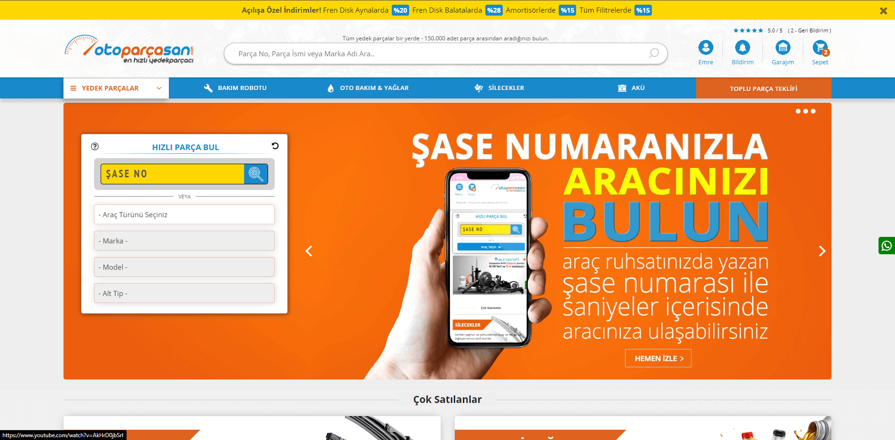

| | |
|---|---|
| **Role** | Senior Frontend Web Developer, end-to-end product delivery (Otoparçasan / Otosesli) |
| **Period** | 2020 – 2021 |
| **Scale** | 500,000-part catalogue across more than 20 web services |
| **Recognition** | Golden Spider Web Awards shortlist, 2021 |
| **Stack** | PHP · CodeIgniter 3 · MySQL · MS SQL Server · jQuery · Bootstrap 4 · Metronic · ECharts · Composer · Gulp |

---

## Contents
- [Highlights](#highlights)
- [Architecture](#architecture)
- [Order fulfilment pipeline](#order-fulfilment-pipeline)
- [Integrations](#integrations)
- [Screenshots](#screenshots)
- [Repository layout](#repository-layout)
- [Running it](#running-it)
- [Timeline](#timeline)
- [What I would do differently today](#what-i-would-do-differently-today)

## Highlights

- **Fitment-first shopping.** The VIN or vehicle selector (type → make → model → sub-model → engine) drives every listing, so customers only see parts that fit. Each part lists alternative brands with live prices and a delivery date.
- **Line-level fulfilment state machine.** Every order line moves through payment, supplier approval, goods receipt, dispatch and shipping. Supplier confirmations are **batched by supplier and SKU across all open orders**, so one click confirms a purchase for every waiting customer.
- **ERP-backed catalogue.** Stock, product groups, prices and OEM cross-references come from a Netsis ERP on MS SQL Server through a small JSON service, so the shop never keeps a second copy of the catalogue.
- **Pricing and delivery engine.** The sale price is ERP price + per-supplier margin + VAT. The delivery estimate combines supplier warehouse lead times, a 14:00 cut-off and a holiday calendar.
- **Back office with 40+ modules.** Orders, suppliers and margins, catalogue, variants and bundles, campaigns and gift cheques, reviews and Q&A, support conversations, notifications (email, SMS, push), e-invoices, CMS and translations.
- **Three generations in one repo.** Procedural PHP → CodeIgniter 3 MVC (v1) → v2 with the fulfilment pipeline and supplier management. The commit history shows the migration step by step.

## Architecture

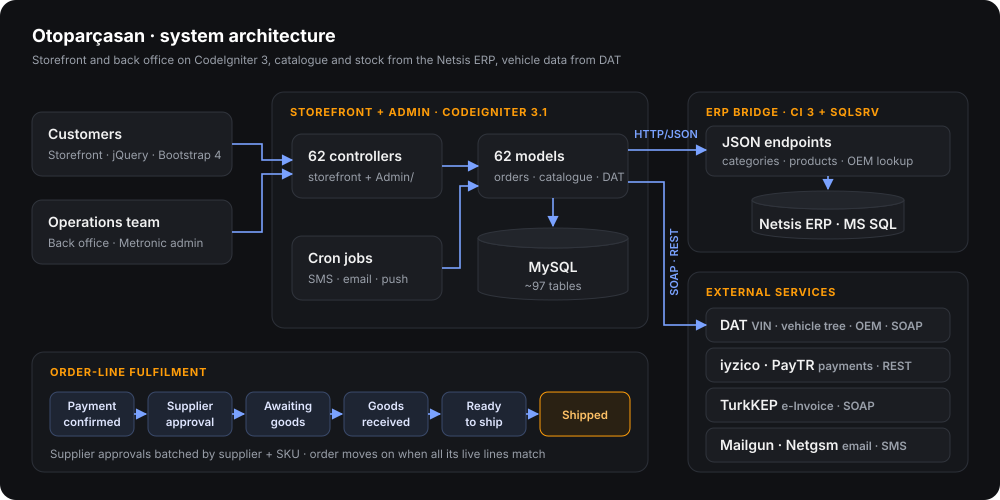

- **Storefront and admin** share one CodeIgniter 3 application (`storefront/`). Admin controllers and views live under `Admin/`.
- **ERP bridge** (`erp-api/`) is a separate deployment that talks to SQL Server through the `sqlsrv` driver and only exposes read endpoints such as `getCategories`, `getProductsByOem` and `getProductsDetailByKod`.
- **Vehicle data** comes from DAT over SOAP, with token refresh, cascading selectors and a VIN cache table.

## Order fulfilment pipeline

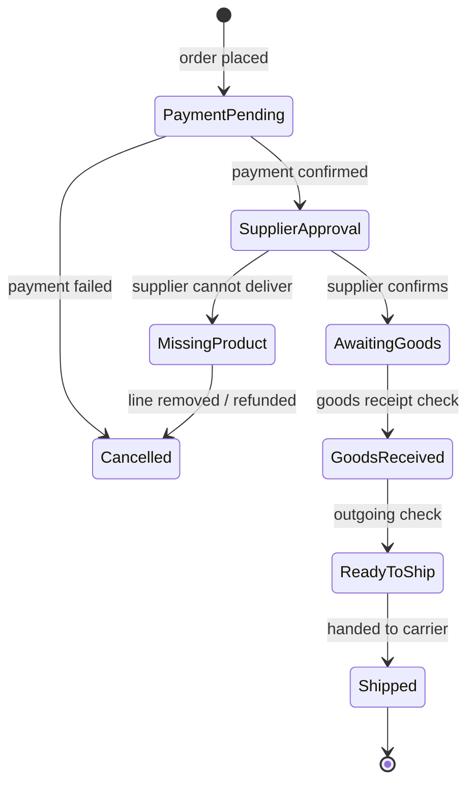

| Code | State (admin label) | Screen |
|---|---|---|
| 1 | Payment pending (*Ödeme Onayında*) | Payment check |
| 2 | Supplier approval (*Tedarik Onayında*) | [Supplier approval](docs/screenshots/admin-supplier-approval.png) |
| 3 | Awaiting goods (*Ürün Bekleniyor*) | Goods receipt |
| 4 | Goods received (*Gelen Ürün Onay*) | [Goods receipt](docs/screenshots/admin-goods-receipt.png) |
| 5 | Ready to ship (*Giden Ürün Onay*) | [Dispatch](docs/screenshots/admin-dispatch.png) |
| 6 | Shipped (*Kargoya Verildi*) | Order list |
| 7 | Cancelled (*İptal Edildi*) | Refunds |
| 8 | Missing product (*Eksik Ürün*) | Missing products |

States are stored per **order line** (`order_line.status_inside`). The order's own status is derived from its lines: it only advances when every non-cancelled line has reached the same stage. That is how partial deliveries and missing items are handled without blocking the rest of the order.

```php
// storefront/application/models/Admin/Order_model.php — supplier confirmation, batched across orders
$this->db->where(['cari_id' => $supplier, 'stok_id' => $sku, 'status_inside' => 2]);
$this->db->where_in('order_id', $paidOrdersAwaitingSupplier);
$this->db->set(['status_inside' => 3])->update('order_line');

// roll the order forward only when all of its live lines are at stage 3
$this->db->query('UPDATE orders SET order_status = 2, order_status_inside = 3
    WHERE id IN (SELECT a.order_id
                   FROM (SELECT order_id, SUM(count) count FROM order_line WHERE status_inside != 7 GROUP BY order_id) a
                   JOIN (SELECT order_id, SUM(count) count FROM order_line WHERE status_inside = 3  GROUP BY order_id) g
                     ON a.order_id = g.order_id
                  WHERE a.count = g.count)
      AND order_status NOT IN (3, 4)');
```

## Integrations

| Service | Purpose | Where |
|---|---|---|
| **DAT** | VIN decoding, vehicle tree, OEM part numbers (SOAP + token auth) | `models/Dat_model.php`, `controllers/Service.php` |
| **Netsis ERP** | Stock, groups, prices, OEM cross-reference (MS SQL via bridge) | `erp-api/`, `models/Api_model.php` |
| **iyzico** | Card payments, installments | `libraries/Iyzico.php` |
| **PayTR** | Hosted payments and installment table | `controllers/Cart.php`, `models/Cart_model.php` |
| **TurkKEP** | e-Invoice issuing, status checks and invoice rendering (SOAP, test and live) | `models/Admin/Efatura_Model.php` |
| **Mailgun / SMTP** | Transactional email | `libraries/Mailgunapi.php`, `libraries/Mailler.php` |
| **Netgsm** | SMS notifications | `libraries/Sms.php`, `controllers/Admin/Cron.php` |
| **debounce.io** | Email validation at sign-up | `models/Ajax_model.php` |
| **doviz.com** | Exchange rates | `models/Admin/Currency_model.php` |
| **Facebook / Google** | Social login (`socialconnect/auth`) | `controllers/Sociallogin.php` |

## Screenshots

**Storefront** (production, 2020–2021)

| | |
|---|---|
| 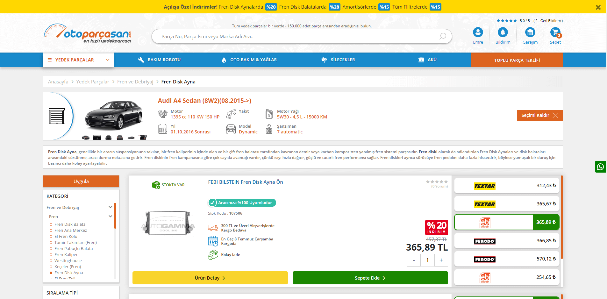 **Vehicle-matched listing:** fitment badge, alternative brands with prices, delivery date | 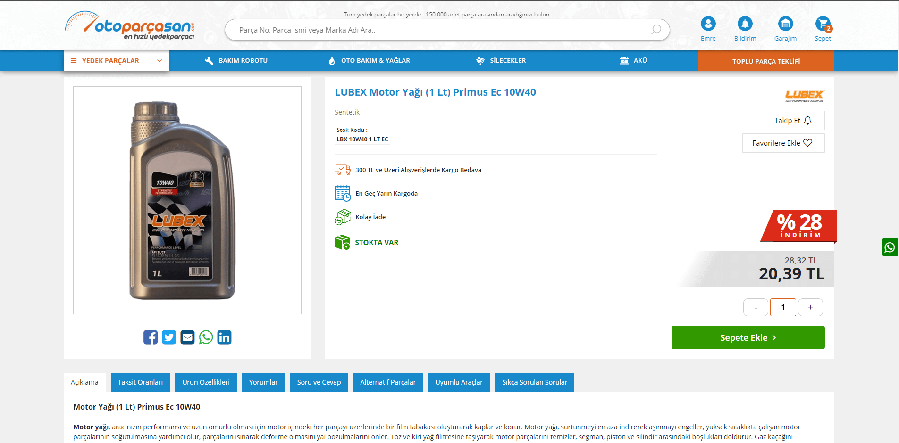 **Product detail:** installments, compatible vehicles, alternative parts |
| 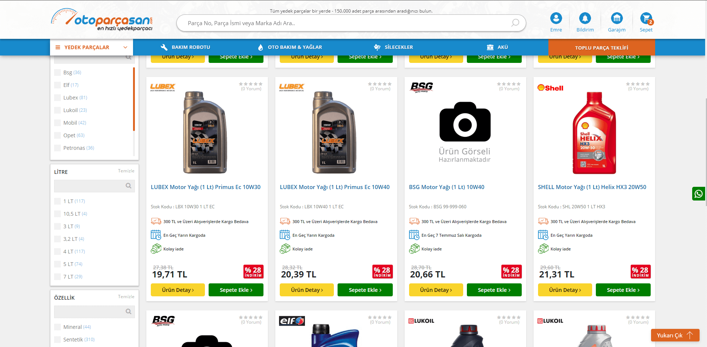 **Category and filters** | 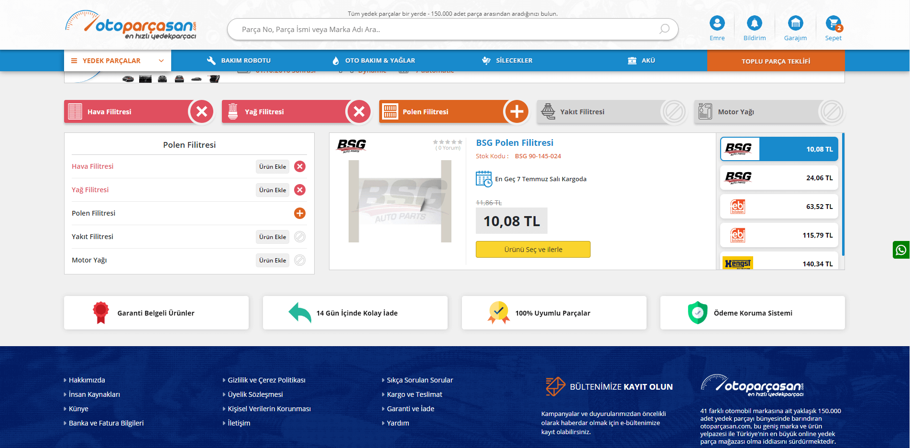 **Maintenance robot:** service kit for the selected vehicle |

**Back office** (real admin views, rendered with fictional demo data)

| | |
|---|---|
| 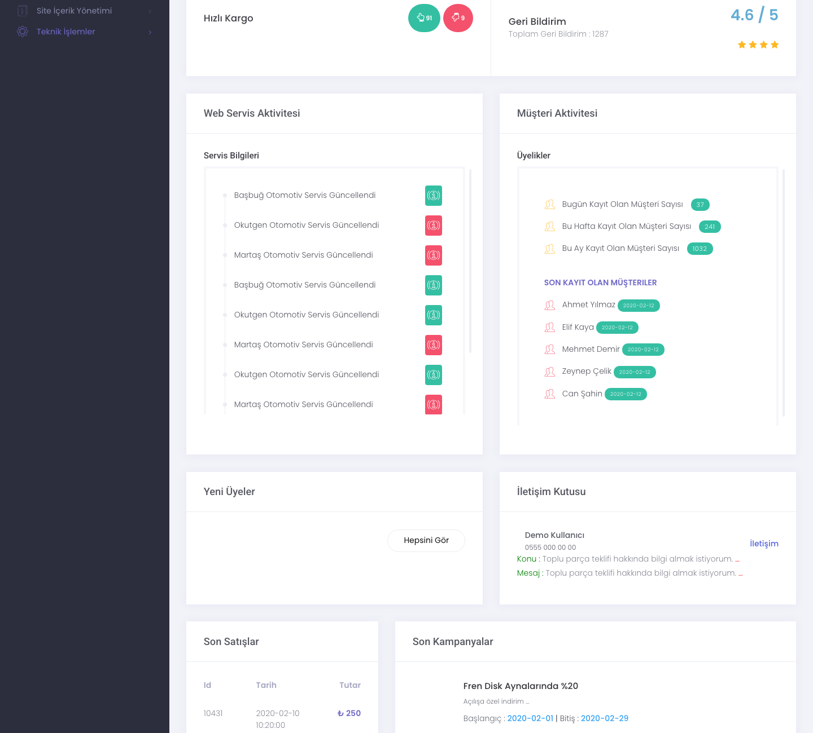 **Dashboard:** offers, Q&A, reviews, satisfaction, latest orders and users | 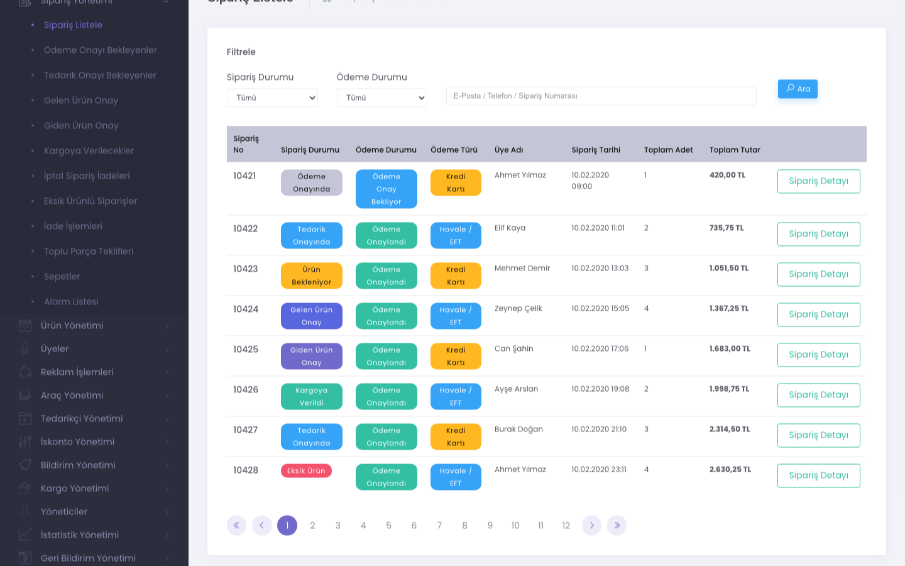 **Orders:** status and payment filters, search, pagination |
|  **Supplier approval:** lines grouped by supplier and SKU | 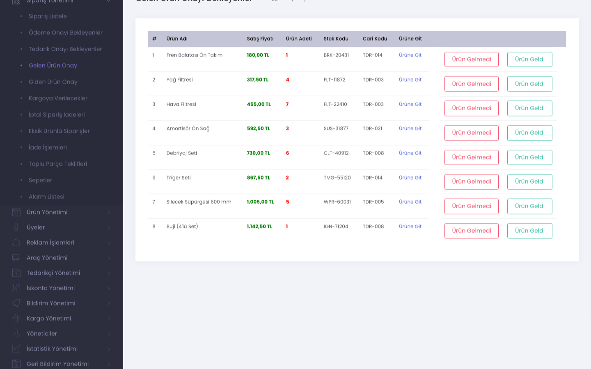 **Goods receipt check** |
| 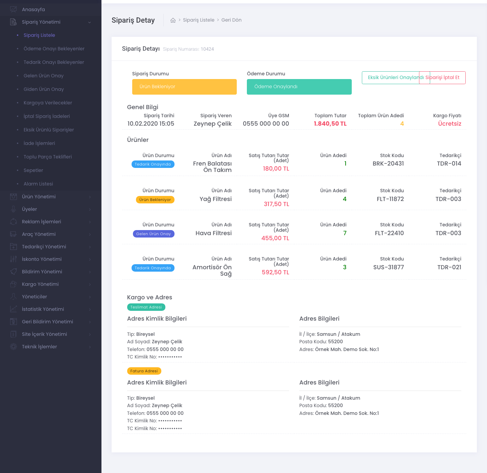 **Order detail:** per-line state, supplier, stock code | 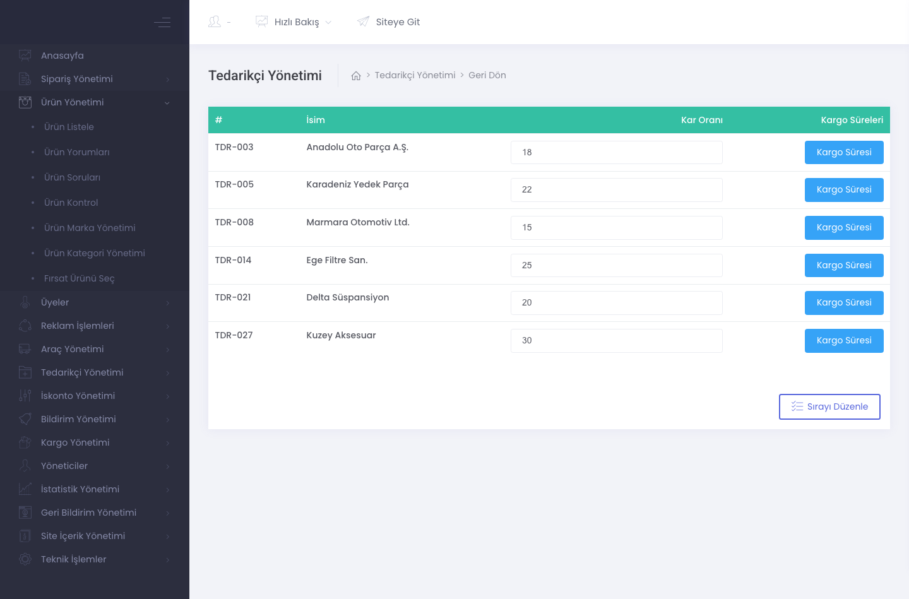 **Suppliers:** margin and carrier lead time |

## Repository layout

```
├── storefront/              CodeIgniter 3 app: storefront + Admin/ back office
│   ├── application/
│   │   ├── controllers/     62 controllers (Admin/ = back office)
│   │   ├── models/          62 models (Order_model, Dat_model, Efatura_Model, …)
│   │   ├── views/           217 views (Admin/, mail/)
│   │   ├── libraries/       Iyzico, Mailgunapi, Sms, Mailler
│   │   └── helpers/         status labels and formatting helpers
│   ├── assets/              storefront CSS/JS, brand logos; admin theme not included
│   └── system/              CodeIgniter 3.1.10
├── erp-api/                 ERP bridge (CodeIgniter 3, sqlsrv → Netsis)
├── legacy/procedural/       Original page-per-file PHP storefront
├── tools/admin-preview/     Renders the admin views with demo data, no database
├── docs/screenshots/
└── .env.example             Every credential the code reads via getenv()
```

## Running it

This is an archived production codebase: the database schema, data and ERP are not part of the repository.

- **Requirements:** PHP 7.x (CodeIgniter 3.1.10), MySQL, Composer. The ERP bridge also needs the `sqlsrv` extension.
- **Configuration:** every secret is read with `getenv()`. Copy `.env.example` and expose the values through your web server or PHP-FPM pool.
- **Admin preview without a database:**
  ```bash
  php -d short_open_tag=On -S localhost:8085 -t storefront tools/admin-preview/router.php
  # open http://localhost:8085/?v=home  (order, order_supply_check, order_invoming_check, order_go_cargo, order_view, tedarikci_list)
  ```
  Full styling needs a licensed Metronic copy in `storefront/assets/theme/` ([details](storefront/assets/theme/README.md)).

## Timeline

| | |
|---|---|
| **2020** | Legacy procedural storefront brought under version control. Rebuild on CodeIgniter 3 with the Metronic admin, DAT vehicle search, iyzico and TurkKEP e-invoicing. Netsis ERP bridge service. |
| **2021** | v2: line-level fulfilment pipeline, supplier lead times and margins, holiday-aware delivery estimates, PayTR, Mailgun, Netgsm SMS, social login, SEO routes. Golden Spider shortlist. |

## What I would do differently today

- **Explicit state machine.** Replace integer codes with an enum, a transition table and an audit log of every state change, instead of status columns updated in place.
- **Safer mutations.** Several admin actions change state over `GET` and redirect back. Today they would be `POST` + CSRF, idempotent, and wrapped in transactions.
- **Thin controllers.** Pricing and delivery-date rules live in controllers (an eight-branch warehouse lookup, a hand-applied UTC+3 offset). They belong in tested domain services.
- **Configuration.** Credentials used to live in code. In this archive they were moved to environment variables; today they would sit in a secrets manager from day one.
- **Frontend.** jQuery views would become typed React components with a shared design system, and the admin tables would be server-paginated data grids.

---

<sub>Built for Otoparçasan / Otosesli. Archived for portfolio purposes: credentials, customer data and the commercial Metronic theme have been removed, and the admin screenshots use fictional data. No license is granted for reuse.</sub>
